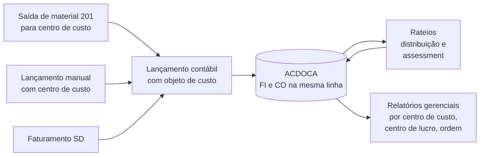

# SAP CO - Study

> Nível: noção
> Controlling: centros de custo, centros de lucro, ordens internas e a ligação com o FI. Estudo de leitura,
> sem prática no trial. Relacionados: [SAP-FI-erp-study](https://github.com/igor-barral/SAP-FI-erp-study),
> [SAP-MM-erp-study](https://github.com/igor-barral/SAP-MM-erp-study), [SAP-SD-erp-study](https://github.com/igor-barral/SAP-SD-erp-study),
> [SAP-S4HANA-erp-study](https://github.com/igor-barral/SAP-S4HANA-erp-study).

## Objetivo

Saber o suficiente de CO para ler uma especificação que fala em centro de custo, centro de lucro ou ordem
interna, entender por que as vagas pedem "FI/CO" e saber onde os dados de custo ficam no S/4HANA. Este
repositório é de noção: não há exercício no trial, só o conceito, o vocabulário e as respostas.

Ao concluir este estudo você deverá ser capaz de responder perguntas como:

- Qual a diferença entre FI e CO?
- Por que as vagas escrevem "FI/CO" junto?
- O que são centro de custo, centro de lucro e ordem interna?
- Onde ficam os lançamentos de CO no S/4HANA?

## Ponte

Num ERP próprio, é comum ter uma coluna `centro_custo_id` nos lançamentos e um relatório gerencial que soma por
ela. O CO é essa ideia formalizada: a contabilidade financeira (FI) responde "quanto a empresa gastou e deve,
para fins legais"; a controladoria (CO) responde "quem gastou, em quê e quanto cada área ou produto rende,
para fins gerenciais".

## Conteúdo

### Objetos principais

| Objeto | Para que serve | Transação (clássica) | Tabela mestre |
|---|---|---|---|
| Área de contabilidade de custos | Nível organizacional do CO; agrupa uma ou mais empresas | configuração | `TKA01` |
| Centro de custo | Área que consome recursos (manutenção, RH, TI) | `KS01` / `KS02` / `KS03` | `CSKS` |
| Centro de lucro | Unidade avaliada por resultado (linha de negócio, filial) | `KE51` / `KE52` / `KE53` | `CEPC` |
| Ordem interna | Coletor temporário de custos (evento, projeto pequeno, campanha) | `KO01` / `KO02` / `KO03` | `AUFK` |
| Natureza de custo | Classificação do custo | no S/4HANA, é a própria conta do razão (`FS00`) com categoria de natureza de custo | - |

### Como o custo chega ao CO

- Todo lançamento em conta de custo precisa de um **objeto de custo** (centro de custo, ordem, projeto...).
- **Rateios** redistribuem custos entre centros (por exemplo, TI rateada para as áreas por número de usuários).
  No clássico, transações como `KSV5` (distribuição) e `KSU5` (*assessment*); confirme as transações e os apps
  equivalentes no sistema.
- O **centro de lucro** normalmente é derivado do centro de custo, do material ou de outro objeto, e permite
  demonstrativo de resultado por unidade.
- A **análise de rentabilidade** (CO-PA) recebe receita e custo do faturamento para análise por cliente,
  produto e região.

### ECC vs. S/4HANA

| Tema | ECC | S/4HANA |
|---|---|---|
| Itens de CO | `COEP` (e totais em `COSP`/`COSS`) | `ACDOCA`, na mesma linha do item FI |
| Natureza de custo | Objeto próprio (`KA01`) | Conta do razão com categoria de natureza de custo |
| Reconciliação FI-CO | Necessária (*reconciliation ledger*) | Deixa de existir: FI e CO gravam no mesmo lugar |

### Onde o desenvolvedor encontra CO

- Relatórios gerenciais custom (orçado vs. realizado por centro de custo).
- Interfaces que lançam despesas e precisam informar o objeto de custo correto.
- Derivações e validações de objeto de custo (em geral configuração; código só quando necessário).

## Respostas

**Qual a diferença entre FI e CO?**
FI é a contabilidade externa (legal): balanço, demonstrativo de resultado, obrigações com fornecedores e
clientes. CO é a contabilidade interna (gerencial): custos por área, por produto, por ordem, e resultado por
unidade de negócio. O FI segue a norma contábil; o CO segue a necessidade de gestão.

**Por que as vagas escrevem "FI/CO" junto?**
Porque os dois módulos são alimentados pelos mesmos lançamentos e o consultor normalmente configura os dois.
No S/4HANA a ligação ficou ainda mais forte: FI e CO gravam no mesmo `ACDOCA`, e a natureza de custo passou a
ser a própria conta do razão.

**O que são centro de custo, centro de lucro e ordem interna?**
Centro de custo é a área que consome recursos. Centro de lucro é a unidade avaliada por resultado (receita
menos custo). Ordem interna é um coletor temporário de custos para um evento ou iniciativa específica.

**Onde ficam os lançamentos de CO no S/4HANA?**
No Universal Journal (`ACDOCA`), com os campos de centro de custo, ordem e centro de lucro na mesma linha do
item contábil. As tabelas antigas (`COEP` e totais) ficam acessíveis por compatibilidade; confirme na
*simplification list* o comportamento de cada uma.

## Referências

- SAP Help Portal: https://help.sap.com (busque "Controlling" e "Overhead Accounting" na documentação do SAP
  S/4HANA).
- SAP Learning: https://learning.sap.com (trilhas introdutórias de Finance e Controlling no S/4HANA).
- SAP Community: https://community.sap.com (busque "Controlling").
